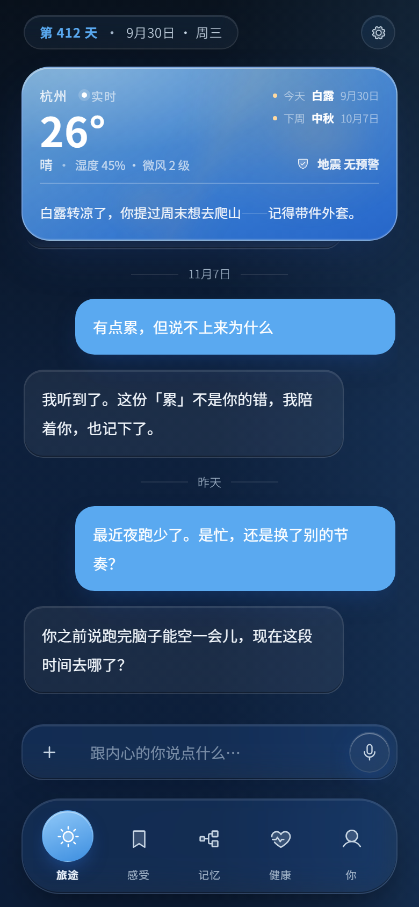
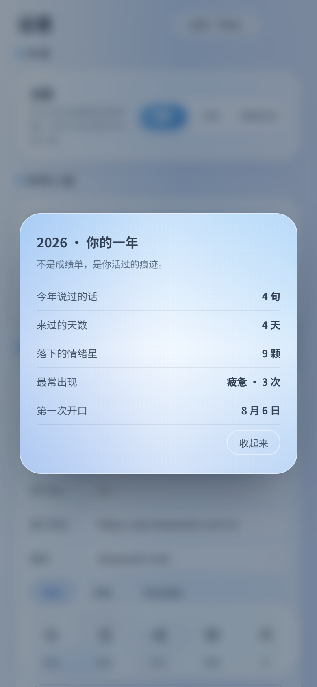

# 人生档案 · LifeArchive

> **竞品做记录，我们做档案——随时间生长、能被重新理解的东西。**
>
> 一个 AI 陪伴式个人档案：每天跟它说说话，它把你的情绪、事件、关系沉淀成一份只属于你的档案。

<p align="center">
  
  
  
</p>

<p align="center">
  <a href="https://onestar1107.github.io/life-archive/"><b>▶ 在线打开</b></a> ·
  <a href="https://onestar1107.github.io/life-archive/prototype/"><b>直接进原型</b></a> ·
  <a href="docs/screenshots/">全部截图</a> ·
  <a href="ui-refs/">设计稿</a> ·
  <a href="灵感tips.txt">产品方向库</a>
  <br /><br />
  
  
  
  
</p>

---

## 三十秒看懂

- **它是什么**：一个情绪与记忆档案。打开就是「第 412 天 · 今天」，低压力地让你开口，而不是扔一张空白表单。
- **它特别在哪**：不追打卡、不做绩效。它记得你说过的事，也记得**三个月前的你和现在的你不一样**。
- **它怎么跑**：一个 HTML 文件，双击就开，零依赖、零构建；数据只在你自己的浏览器里。

## 界面

<table>
  <tr>
    <td align="center"><br /><sub><b>旅途</b><br />天气 · 对话 · 语音</sub></td>
    <td align="center"><br /><sub><b>说出你的情绪</b><br />说完还会追问「更准的说法」</sub></td>
    <td align="center"><br /><sub><b>感受</b><br />从记录里长出规律</sub></td>
  </tr>
  <tr>
    <td align="center"><br /><sub><b>我懂你多少</b><br />自适应居中，节点带具象图标</sub></td>
    <td align="center"><br /><sub><b>情绪星夜</b><br />说出口的感觉点亮一颗星</sub></td>
    <td align="center"><br /><sub><b>设置</b><br />导师人格 · 自带模型 · 档案</sub></td>
  </tr>
</table>

<p align="center">
  
  
  
</p>
<p align="center"><sub>周复盘信（周日晚上自动出现） · 年度报告（Wrapped 式） · 深色模式</sub></p>

## 原型里已有什么

**记录与对话**

| | |
|---|---|
| **今日简报** | 每天第一次打开自动出现，不用点按钮 |
| **一次只回一条** | 回复是「先接住情绪 + 一句具体引导」，两段合成一条，不刷屏 |
| **语音消息** | 按住说话（长按输入框也行）；松手后可播放、拖动、丢弃；长按进入的发完自动回键盘，点语音键进入的留在语音模式 |
| **添加入口** | `+` 弹出毛玻璃菜单：上传图片 / 上传文件 / 拍照 |
| **回到底部** | 上滑后浮出一个圆形箭头，点一下平滑回底；与撤销条互斥、同位置同高 |
| **记录会留下** | 聊天 / 情绪 / 洞察写进 localStorage，刷新不丢；写不进去会明说 |

**理解与回望**

| | |
|---|---|
| **情绪粒度** | 说「憋屈」时再追问一句「更准的说法」——144 词按四象限组织，选中即改写记录 |
| **双时间戳** | 图谱节点挂着「3 个月」：点开看「当时的我 vs 现在的我」 |
| **跨节点洞察** | 情绪桶 × 反复出现的话题交叉，主动说「你反复提的工作，和你最近的低落，可能不是两件事」 |
| **信念矛盾** | 发现「上个月说喜欢 X、这周说讨厌 X」，把变化摆出来，标注证据条数与把握度 |
| **自我距离化 + CBT** | 反刍时引导「如果是你朋友坐在对面」，并温和点出灾难化 / 以偏概全 |
| **导师人格** | 斯多葛 / 温柔教练 / 犀利诤友，同一周记录三种语气 |
| **周复盘信** | 周日 20:00 后第一次打开，把本周记录合成一段回望 |
| **沉默也记录** | 连续 5 天没打开，不催不推，只在档案里写一行 |
| **年度报告 + 时间胶囊** | Wrapped 式一年统计；写给一年后的自己，365 天解锁 |
| **感恩练习** | 今日简报里一条「今天让你感激的一件小事」 |

**真实数据**

| | |
|---|---|
| **地震提醒** | 轮询 USGS 实时目录（中国区域，M≥4，近 24 小时），命中新震时在聊天里推一条，并在已授权时弹系统通知 |
| **为什么不是 CENC** | 中国地震台网官网是 React SPA，没有可直接跨域调用的公开接口；要接 CENC 需服务端代理（工程版做这层）。原型先用 USGS 保证是真实数据 |

> **关于联网**：原型只有地震这一处会发网络请求；对话、情绪、洞察、复盘全部在本机完成。
> **关于通知**：`new Notification()` 只在页面打开时生效；锁屏/后台推送需要 PWA + Service Worker + 推送服务器，已列入待办。

## 图标与视觉

- **图标**：62 个 Phosphor Duotone（MIT）内联 SVG，按内容分蓝 / 沙绿 / 琥珀三档
- **语义映射**：`Icons.forText()` 按关键词命中——夜跑→跑步、学吉他→吉他、法语→书、有点累→心碎
- **统一容器**：观察卡 / 状态卡 / 我记得的事，图标容器一律 40px 蓝调方块
- **零 emoji**：全站已清掉 emoji，只保留 `✓ ✕ ★` 这类几何符号
- **玻璃**：`backdrop-filter` + 半透明白 + 顶部高光，浮层与内容之间用 10~32px 的渐隐过渡

## 设计思路（这个项目的真正主角）

原型阶段的代码只是载体，想法才是资产。

**核心洞察**：产品叫「档案」，时间就是灵魂。竞品做的是「记录」——流水账，记完就沉底；我们想做的是「档案」——随时间生长、能被重新理解的东西。

**三个差异化方向**（完整清单见 [灵感tips.txt](灵感tips.txt)）：

1. **情绪粒度训练（Mood Meter）**——把「难受」精确到「憋屈 / 不甘 / 被忽视」（耶鲁 RULER 框架 144 词）
2. **双时间戳**——能看见「三个月前我为 X 焦虑、现在已释然」，竞品都没有
3. **「你可能没意识到」**——跨节点推理，把「记忆」升级为「洞察」

**设计系统**：冰川记忆——冰川蓝品牌色 + 四色情绪星（烦躁红 / 微暖琥珀 / 青绿 / 冰川蓝）。界面只保留左上角胶囊作为页面名，大标题与解释性副标题一律删掉——内容自己说话。

**参考与致敬**：How We Feel（Mood Meter）、Zep Graphiti（双时间戳）、Mindsera（导师人格）、Woebot（CBT 温和提示）、Ethan Kross（自我距离化）、Bencho（语音条，MIT）。

## 工程版

同一份设计的正式工程在 `frontend/`（uni-app x，uts 编译到 Kotlin / Swift / ArkTS）与 `backend/`（NestJS 10 + Prisma + PostgreSQL 16）：

| 层 | 选择 |
|---|---|
| 移动端 | **uni-app x**（VDOM 模式）——iOS / Android / HarmonyOS NEXT 同源 |
| 后端 | **NestJS 10** + Prisma 6 + **PostgreSQL 16**，REST + OpenAPI |
| 认证 | JWT Access (15 min) + Refresh (7 d)，轮换 + 重放检测 |
| 隐私 | 首启同意弹窗，未同意前零采集 |

三条由门禁强制执行的硬规则：业务源码不进仓库根、业务代码零 `#ifdef`、仓库内零真实密钥。

## 项目结构

```text
.
├── index.html                        # 在线落地页（GitHub Pages 入口）
├── prototype/index.html              # 原型本体（单文件，零依赖，双击即跑）
├── docs/
│   ├── screenshots/                  # 本页所有截图（9 张）
│   ├── prd.md / todo.md / status.md  # 人 + AI 协作文档体系
│   └── project/                      # 工程约定
├── frontend/                         # uni-app x 三端工程
├── backend/                          # NestJS + Prisma
├── ui-refs/                          # 设计稿与 token
└── 灵感tips.txt                      # 产品方向库
```

## 路线图

- [x] 概念原型：每日一问 / 情绪 / 星夜 / 图谱 / 身体信号 / 自带模型（110+ 版迭代）
- [x] 情绪粒度 144 词 · 双时间戳 · 跨节点洞察 · 自我距离化 + CBT
- [x] 导师人格 / 信念矛盾 / 周复盘信 / 沉默也记录 / 年度报告 + 时间胶囊
- [x] 全站去 emoji，换成 62 个具象图标 + 语义映射
- [x] 语音消息、`+` 菜单、回到底部、撤销条让位
- [x] 地震提醒接真实数据（USGS）
- [ ] 后台推送（PWA + Service Worker + 推送服务器）
- [ ] CENC 服务端代理
- [ ] 观察卡与图谱改成数据驱动（当前仍是静态样板）

## License

[MIT](LICENSE) —— 随便看、随便改、保留署名即可。
