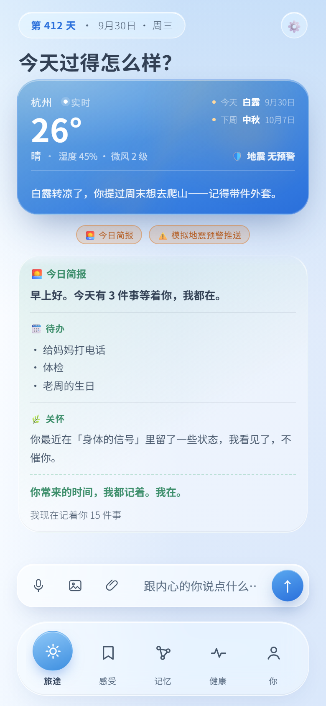
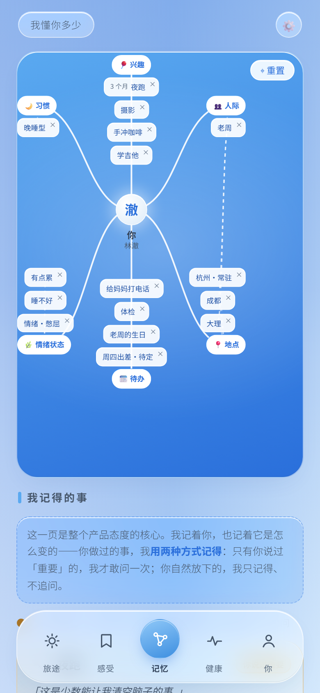
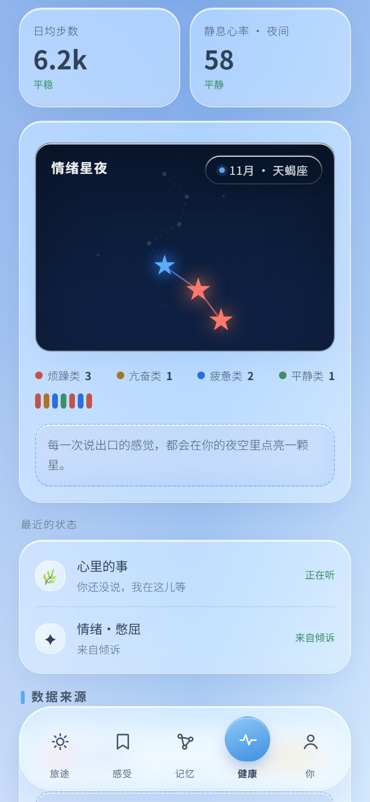
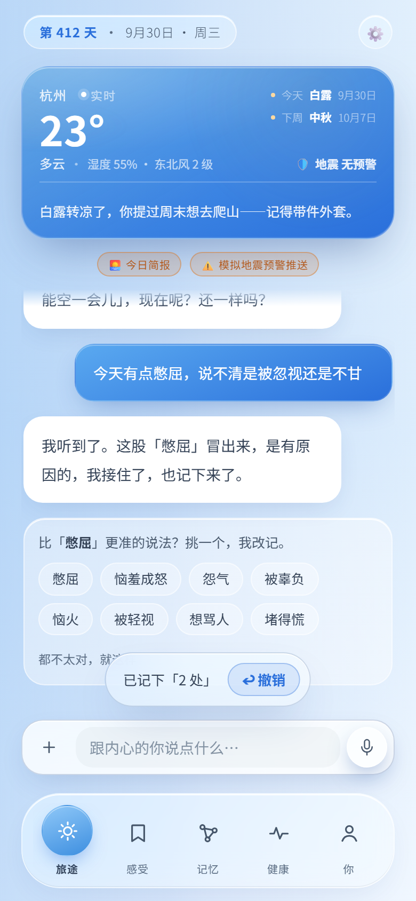
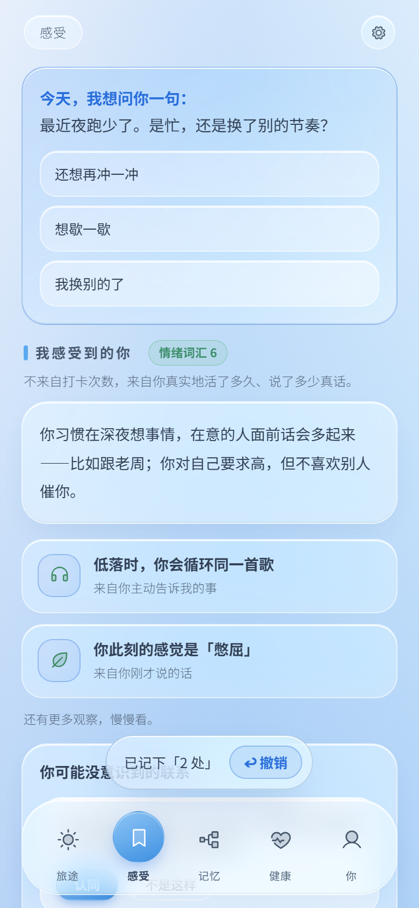
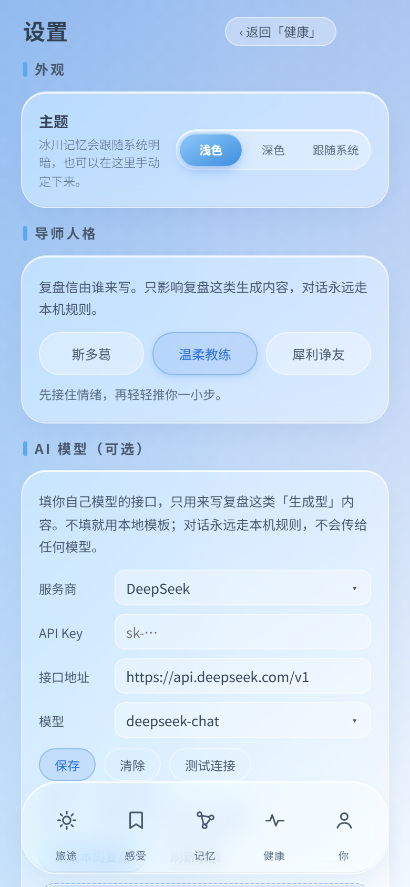
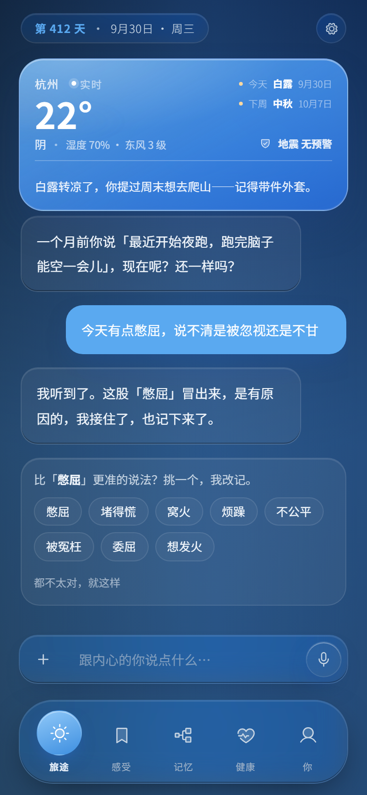

# 人生档案 · LifeArchive

> **竞品做记录，我们做档案——随时间生长、能被重新理解的东西。**
>
> 一个 AI 陪伴式个人档案：每天跟它说说话，它把你的情绪、事件、关系沉淀成一份只属于你的档案。

<p align="center">
  
  
  
</p>

<p align="center">
  <a href="https://onestar1107.github.io/life-archive/"><b>▶ 在线打开</b></a> ·
  <a href="docs/screenshots/">全部截图</a> ·
  <a href="ui-refs/">设计稿</a> ·
  <a href="灵感tips.txt">产品方向库</a>
  <br /><br />
  
  
  
  
</p>

---

## 三十秒看懂

- **它是什么**：一个情绪与记忆档案。打开就是一句"今天过得怎么样？"——低压力地让你开口，而不是扔一张空白表单。
- **它特别在哪**：不追打卡、不做绩效。它记得你说过的事，也记得**三个月前的你和现在的你不一样**。
- **它怎么跑**：一个 HTML 文件，双击就开，零依赖、零网络请求，数据只存在你自己的浏览器里。

## 界面

<table>
  <tr>
    <td align="center"><br /><sub><b>今日问候</b><br />天气 + 今日简报</sub></td>
    <td align="center"><br /><sub><b>说出你的情绪</b><br />说完就记下</sub></td>
    <td align="center"><br /><sub><b>感受</b><br />从记录里长出规律</sub></td>
  </tr>
  <tr>
    <td align="center"><br /><sub><b>记忆图谱</b><br />你告诉我一件事，就长出一个节点</sub></td>
    <td align="center"><br /><sub><b>情绪星夜</b><br />说出口的感觉点亮一颗星</sub></td>
    <td align="center"><br /><sub><b>设置</b><br />主题 / 自带模型</sub></td>
  </tr>
</table>

<p align="center">
  <br />
  <sub>深色模式：完整设计令牌驱动，不是反色</sub>
</p>

## 原型里已有什么

| | |
|---|---|
| **今日简报** | 每天第一次打开，不等你点，直接把简报推进聊天框（同一天不重复） |
| **记录会留下** | 聊天 / 情绪 / 洞察写进浏览器本地（`la.messages / la.emotions / la.insights / la.profile`，带 schemaVersion 与迁移），刷新不丢；写不进去会明说「这次记录没存上」 |
| **时间回访** | 7 天 / 30 天后自动回问一句「三周前你说……现在呢？」 |
| **触发式洞察** | 连续 3 天同一情绪桶 + 反复出现的同一个关键词，才长出「你可能没意识到」——不是写死的卡片 |
| **记忆图谱** | 点节点上的 × 可以删掉我记错的；记错了就该能被拿走 |
| **情绪星夜** | 四类情绪（烦躁 / 亢奋 / 疲惫 / 平静）在夜空里连成星座 |
| **自带模型（可选）** | Key 前缀认厂商、模型自动带出、真实余额与调用统计；只用于复盘这类生成型内容，**对话永远走本机规则** |
| **危机保护** | 检测到自伤 / 危机表达时，给求助热线，不装心理咨询师 |
| **情绪粒度** | 说「憋屈」时再追问一句「更准的说法」——憋屈 / 不甘 / 被忽视 / 心里堵…，共 144 词；选中即改写这次记录，并累积「情绪词汇 N」 |
| **双时间戳** | 图谱节点挂着「3 个月」：点开看「当时的我 vs 现在的我」，首条与最近一条说法并排 |
| **跨节点洞察** | 情绪桶 × 反复出现的话题交叉——「你反复提的工作，和你最近的低落，可能不是两件事」 |
| **自我距离化** | 反刍时引导「如果是你朋友坐在对面，你会怎么跟他说」 |
| **CBT 思维陷阱** | 温和点出「灾难化 / 以偏概全 / 读心」，给一个更平衡的说法（同会话最多 2 次，不说教） |
| **感恩练习** | 今日简报里一条「今天让你感激的一件小事」，写下来就存进档案 |

> **低配 / 排查画面闪烁**：地址后加 `?lite=1` 会关掉毛玻璃与动效，用来判断是不是玻璃层导致的重绘闪烁。

## 设计思路（这个项目的真正主角）

原型阶段的代码只是载体，想法才是资产。

**核心洞察**：产品叫"档案"，时间就是灵魂。竞品做的是"记录"——流水账，记完就沉底；我们想做的是"档案"——随时间生长、能被重新理解的东西。

**三个差异化方向**（完整清单见 [灵感tips.txt](灵感tips.txt)）：

1. **情绪粒度训练（Mood Meter）**——把"难受"精确到"憋屈 / 不甘 / 被忽视"（耶鲁 RULER 框架 144 词）。情绪命名越准，档案越懂你
2. **双时间戳**——能看见"三个月前我为 X 焦虑、现在已释然"，竞品都没有
3. **"你可能没意识到"**——跨节点推理，把"记忆"升级为"洞察"

**设计系统**：冰川记忆——冰川蓝品牌色 + 四色情绪星，令牌来自设计稿（见 `ui-refs/`）。

**参考与致敬**：How We Feel（Mood Meter）、Zep Graphiti（双时间戳）、Woebot（CBT 温和提示）、Ethan Kross（自我距离化）。

## 工程版（Flutter 级别之外的三端同源）

同一份设计的正式工程在 `frontend/`（uni-app x，uts 编译到 Kotlin / Swift / ArkTS）与 `backend/`（NestJS 10 + Prisma + PostgreSQL 16）：

| 层 | 选择 |
|---|---|
| 移动端 | **uni-app x**（VDOM 模式）——iOS / Android / HarmonyOS NEXT 同源 |
| 后端 | **NestJS 10** + Prisma 6 + **PostgreSQL 16**，REST + OpenAPI |
| 认证 | JWT Access (15 min) + Refresh (7 d)，轮换 + 重放检测 |
| 隐私 | 首启同意弹窗，未同意前零采集；洞察用本地 RULER 词表，不接 LLM |

三条由门禁强制执行的硬规则：业务源码不进仓库根、业务代码零 `#ifdef`（平台差异集中在 `frontend/core/platform/`）、仓库内零真实密钥（`scripts/check-secrets.mjs` 泄漏即失败）。

```bash
# 后端
cd backend && cp .env.example .env && docker compose up -d
pnpm install && pnpm prisma migrate deploy && pnpm seed && pnpm start:dev
# 前端：用 HBuilderX 4.61+ 打开 frontend/，跑模拟器
```

## 项目结构

```text
.
├── index.html                        # 在线落地页（GitHub Pages 入口）
├── prototype/index.html              # 原型本体（单文件，零依赖，Pages 可直接打开）
├── docs/
│   ├── screenshots/                  # README 截图
│   ├── prd.md / todo.md / status.md  # 人 + AI 协作文档体系
│   └── project/                      # 工程约定
├── frontend/                         # uni-app x 三端工程
├── backend/                          # NestJS + Prisma
├── ui-refs/                          # 设计稿与 token
└── 灵感tips.txt                      # 产品方向库
```

## 路线图

- [x] 概念原型：每日一问 / 说出你的情绪 / 情绪星夜 / 记忆图谱 / 身体信号 / 自带模型（历经 80+ 版迭代）
- [x] 三端工程骨架：uni-app x + NestJS
- [x] 情绪粒度训练：Mood Meter 144 词（四象限 144 个中文情绪词）
- [x] 记忆时间轴：双时间戳（当时的我 vs 现在的我）
- [x] 跨节点洞察：情绪桶 × 话题交叉（你可能没意识到）
- [x] 自我距离化 + CBT 思维陷阱识别
- [x] 感恩练习（晨间简报）
- [ ] 年度报告 + 时间胶囊（给一年后的自己写信）
- [ ] 遗忘仪式：把过期烦恼"送走"

## License

[MIT](LICENSE) —— 随便看、随便改、保留署名即可。
